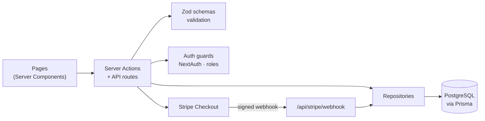
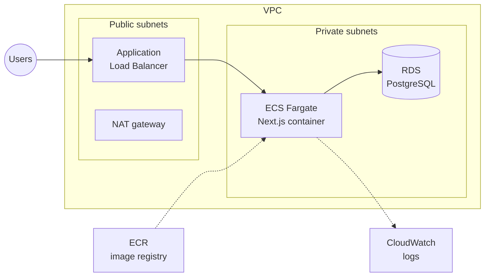

<div align="center">

# Bozarts

**An art-and-craft marketplace where artisans sell their work, run events and talk to their buyers.**

[](https://github.com/AmidNova/bozarts-v2/actions/workflows/ci.yml)


</div>

---

## Overview

Bozarts started as an ISEP team project. This second version is a solo rewrite on a current stack: Next.js 16 with Server Components and Server Actions, Prisma 7 on PostgreSQL, Stripe Checkout for payments, and the AWS infrastructure to host it described in Terraform.

Three roles share one app:

| Role | What they can do |
| --- | --- |
| **Client** | Browse and search the catalogue by category, fill a cart, pay with Stripe, follow orders, review products, message artisans, sign up for events. |
| **Artisan** | Publish and edit products, handle the orders they receive, create events, answer messages. |
| **Admin** | Manage users, products and orders, moderate reviews, edit the FAQ and terms of use. |

## Architecture



Every mutation goes through the same path: a Server Action checks the session and role, validates its input with Zod, calls a repository, and returns a typed `ActionResult<T>` (`{ success: true, data }` or `{ success: false, error }`) that the form can display.

### Data model

14 Prisma models: users with three roles and an account status, products in seven categories, cart items, orders and order items with a five-step status (`PENDING → CONFIRMED → SHIPPED → DELIVERED`, or `CANCELLED`), reviews, messages, events and their participants, plus FAQ and terms-of-use sections editable from the admin.

## Technical choices

- **One data-access layer.** Each entity has a repository in `src/lib/repositories/`, and pages and actions go through it. Registration and the Stripe webhook are the two places that still query Prisma directly.
- **Orders are created in a transaction** from the cart, so a failed step never leaves half an order behind.
- **Payment status comes from Stripe, not the browser.** An order moves to `CONFIRMED` only when the `checkout.session.completed` webhook arrives with a valid signature.
- **Validation at the boundary.** Every form and API input has a Zod schema in `src/lib/schemas/`, including cross-field rules (password confirmation, event end after start).
- **Passwords hashed with bcrypt** (12 rounds); sessions are JWTs from NextAuth's credentials provider.
- **Small production image.** Multi-stage Dockerfile on `node:22-alpine`, Next.js `standalone` output, running as a non-root user.

## Infrastructure

The AWS stack is written as four Terraform modules in [`infra/`](infra), targeting `eu-west-3` (Paris):



| Module | Resources |
| --- | --- |
| `networking` | VPC, public and private subnets, internet gateway, NAT gateway, route tables |
| `ecr` | Image registry with a lifecycle policy |
| `ecs` | Fargate cluster, task definition and service, ALB, security groups, IAM roles, CloudWatch log group |
| `rds` | PostgreSQL instance in the private subnets, reachable only from the ECS security group |

## CI

GitHub Actions runs on every push and pull request to `main`, in three gated jobs: **lint + type-check**, then **tests** against a PostgreSQL 16 service container (schema pushed with Prisma), then a **production build**.

## Run it locally

Requirements: Node.js 22 and Docker.

```bash
git clone https://github.com/AmidNova/bozarts-v2.git
cd bozarts-v2
cp .env.example .env          # set AUTH_SECRET and your Stripe test keys
docker compose up -d db       # PostgreSQL 16
npm ci
npm run db:migrate
npm run db:seed               # demo artisans, clients, products and an admin
npm run dev                   # http://localhost:3000
```

Seeded accounts all use the password `password123`:

| Role | Email |
| --- | --- |
| Admin | `admin@bozarts.fr` |
| Artisan | `marie.leroy@email.com` |
| Client | `jean.dupont@email.com` |

To test payments locally, forward Stripe events with the Stripe CLI:

```bash
stripe listen --forward-to localhost:3000/api/stripe/webhook
```

## Project structure

```
src/
├── app/
│   ├── (shop)/        # catalogue, artisans, cart, checkout, orders, messages, events
│   ├── (dashboard)/   # artisan space and admin back office
│   ├── (auth)/        # login, register
│   ├── actions/       # Server Actions, one file per entity
│   └── api/           # REST routes and the Stripe webhook
├── components/        # UI grouped by feature
└── lib/
    ├── repositories/  # data access
    ├── schemas/       # Zod validation
    └── auth*.ts       # NextAuth config and role guards
prisma/                # schema, migrations, seed
infra/                 # Terraform: networking, ECR, ECS, RDS
```

More detail in [`docs/TECHNICAL.md`](docs/TECHNICAL.md) (in French).

## Limits and next steps

- The test suite is a single smoke test for now; the CI pipeline is ready for real tests on the actions and repositories.
- Terraform state is local: the S3 + DynamoDB backend is written but commented out.
- The load balancer listens on HTTP only; an ACM certificate and an HTTPS listener are the next step.
- Cloudinary is allowed as an image source and listed in `.env.example`, but there is no image upload flow yet.
- No deployment job: images are not yet built and pushed to ECR from CI.

## Author

Soro Amidou · [amidousoro.me](https://amidousoro.me) · [LinkedIn](https://www.linkedin.com/in/amidou-soro-09b94a327/)
